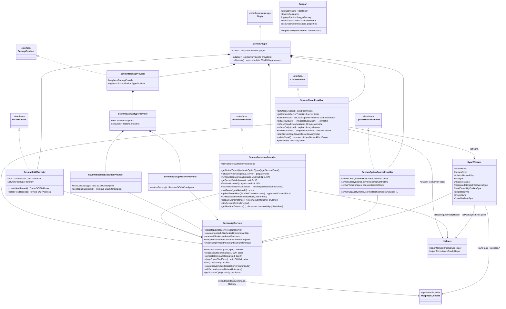
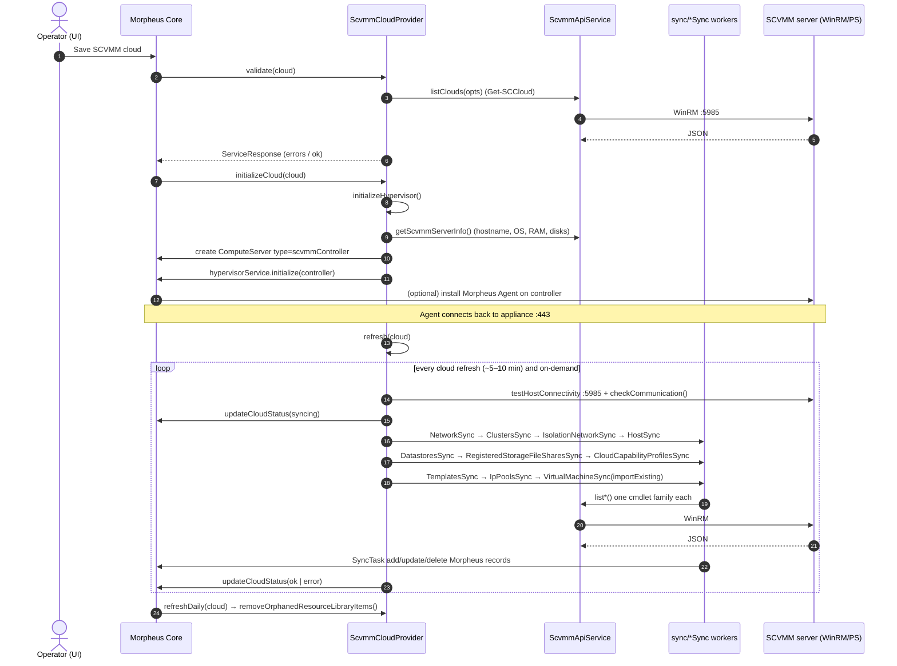
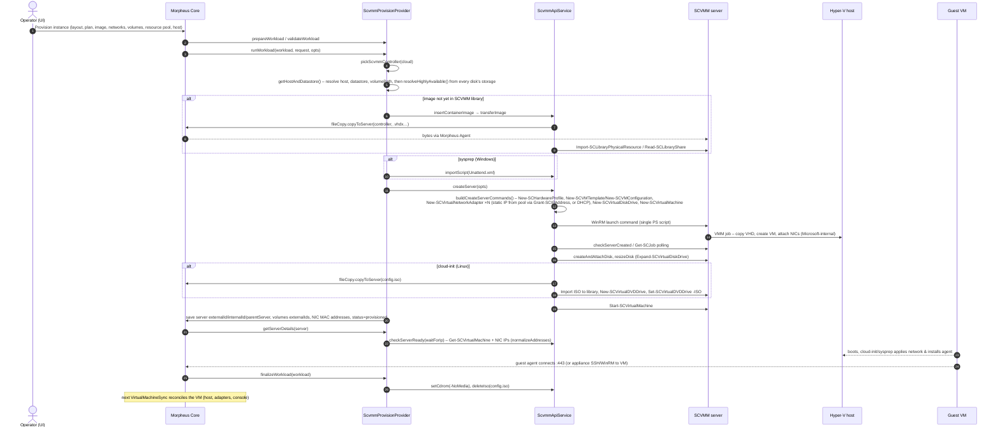
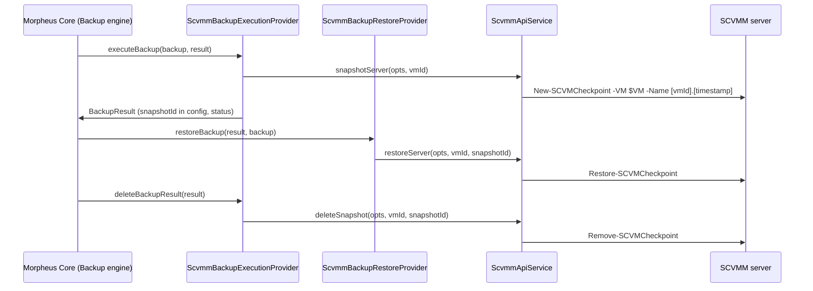
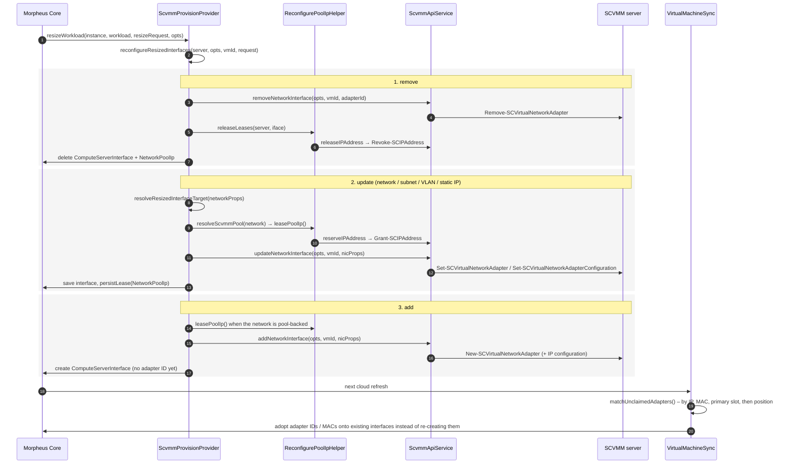
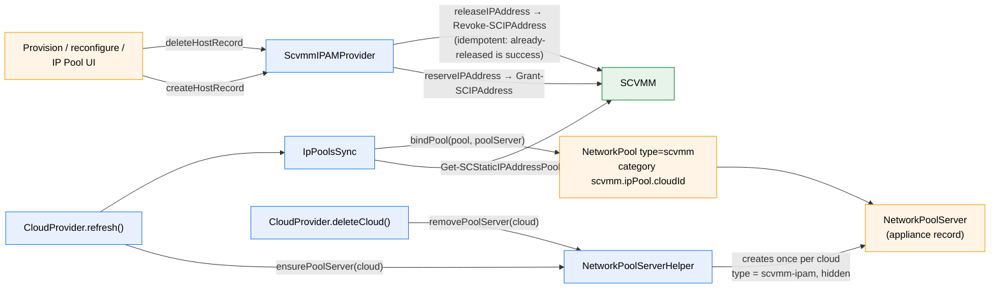
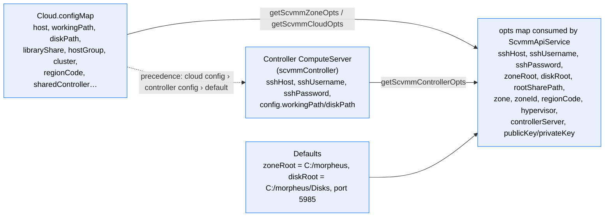

# SCVMM Plugin – Code-Level Design

This document describes how the Morpheus SCVMM plugin is built, how it plugs into the Morpheus appliance and UI, where the
system boundaries are, and which protocols cross each boundary. It is derived from the plugin source in this repository
(`src/main/groovy/com/morpheusdata/scvmm`) and the public
[Morpheus plugin API](https://developer.morpheusdata.com/docs/plugin-development) contracts the plugin implements. The
appliance itself is treated as a black box: only the SPI interfaces and `MorpheusContext` calls the plugin uses are
described here.

Sections:

1. [System context and boundaries](#1-system-context-and-boundaries)
2. [Communication paths](#2-communication-paths)
3. [Plugin component design](#3-plugin-component-design)
4. [How the plugin surfaces in the Morpheus UI](#4-how-the-plugin-surfaces-in-the-morpheus-ui)
5. [Runtime flows](#5-runtime-flows)
6. [Resource mapping: SCVMM → Morpheus](#6-resource-mapping-scvmm--morpheus)
7. [Configuration resolution and the controller model](#7-configuration-resolution-and-the-controller-model)
8. [Cross-cutting concerns](#8-cross-cutting-concerns)
9. [Constraints, risks and known fault lines](#9-constraints-risks-and-known-fault-lines)

---

## 1. System context and boundaries

There are four distinct trust/runtime domains. The plugin itself lives entirely inside the Morpheus appliance JVM; it never
runs code on SCVMM or Hyper‑V directly – it only *sends PowerShell text* to the SCVMM management server and *reads JSON back*.

```mermaid
flowchart LR
    classDef boundary fill:#f7f7f7,stroke:#666,stroke-dasharray: 5 5,color:#000
    classDef plugin fill:#e8f0fe,stroke:#1a73e8,color:#000
    classDef core fill:#fff4e5,stroke:#f29900,color:#000
    classDef ms fill:#e6f4ea,stroke:#137333,color:#000
    classDef guest fill:#fce8e6,stroke:#c5221f,color:#000

    Browser["Operator browser<br/>(Morpheus UI)"]

    subgraph APPL["Boundary A – Morpheus Appliance (JVM)"]
        direction TB
        UI["Morpheus Web UI / REST API"]:::core
        CORE["Morpheus Core<br/>(Plugin Manager, MorpheusContext,<br/>scheduler, DB, agent hub, console proxy)"]:::core
        PLUGIN["<b>morpheus-scvmm-plugin.jar</b><br/>(own classloader)<br/>ScvmmPlugin → providers → ScvmmApiService"]:::plugin
        UI --> CORE
        CORE <-->|"MorpheusContext API<br/>(in-process)"| PLUGIN
    end
    class APPL boundary

    subgraph SCVMM["Boundary B – SCVMM Management Server (Windows)"]
        direction TB
        WINRM["WinRM listener<br/>:5985 / :5986"]:::ms
        AGENT["Morpheus Agent<br/>(node agent, file copy)"]:::ms
        PS["VMM PowerShell module<br/>(Get-/New-/Set-SC*)"]:::ms
        VMMSVC["VMM Service + VMM DB"]:::ms
        LIB["VMM Library Share<br/>(e.g. MSSCVMMLibrary)<br/>ISOs, VHDs, Unattend.xml"]:::ms
        WORK["Working / Disk paths<br/>(workingPath, diskPath)"]:::ms
        WINRM --> PS --> VMMSVC
        AGENT --> WORK
        WORK -.->|Import-SCLibraryPhysicalResource| LIB
    end
    class SCVMM boundary

    subgraph HV["Boundary C – Hyper-V Fabric"]
        direction TB
        HOST1["Hyper-V host / cluster node<br/>(VMM host agent, vmconnect :2179)"]:::ms
        HOST2["Hyper-V host …"]:::ms
        STORAGE["Storage volumes / CSVs /<br/>SMB file shares"]:::ms
        HOST1 --- STORAGE
        HOST2 --- STORAGE
    end
    class HV boundary

    subgraph GUEST["Boundary D – Provisioned guests"]
        VM["VM (Linux / Windows / Docker host)<br/>cloud-init or sysprep,<br/>optional Morpheus guest agent"]:::guest
    end
    class GUEST boundary

    Browser -->|HTTPS :443| UI
    PLUGIN -->|"① WinRM (HTTP :5985)<br/>PowerShell + ConvertTo-Json"| WINRM
    AGENT -->|"② Agent websocket → appliance :443<br/>(outbound from SCVMM)"| CORE
    CORE -->|"③ File copy via agent<br/>(cloud-init ISO, Unattend.xml, VHDs)"| AGENT
    VMMSVC -->|"④ VMM-internal (WinRM/BITS/SMB)<br/>owned by Microsoft, not by the plugin"| HOST1
    VMMSVC --> HOST2
    HOST1 -->|hosts| VM
    CORE -->|"⑤ Hypervisor console (vmrdp :2179)<br/>proxied to browser"| HOST1
    VM -->|"⑥ Guest agent → appliance :443<br/>(or SSH/WinRM from appliance)"| CORE
    LIB -.->|"template / ISO / VHD used at deploy"| HOST1
```

### Boundary summary

| Boundary | What lives there | Who owns it | What the plugin knows about it |
|---|---|---|---|
| **A – Morpheus appliance** | UI, core services, DB, plugin JVM | HPE/Morpheus | Everything – the plugin *is* here. All access to Morpheus data goes through `MorpheusContext` (`context.services.*` sync, `context.async.*` RxJava). |
| **B – SCVMM manager** | WinRM endpoint, VMM PowerShell, VMM DB, library share, Morpheus Agent | Customer (Windows admin) | Modelled as one `ComputeServer` of type `scvmmController`. Plugin knows host, credentials, working/disk/library paths. |
| **C – Hyper‑V fabric** | Hosts, clusters, host groups, storage volumes, file shares, logical/VM networks | Customer (SCVMM admin) | Discovered *through* SCVMM only. Modelled as `scvmmHypervisor` ComputeServers, `CloudPool`s, `Datastore`s, `Network`s, `NetworkPool`s. The plugin never opens a connection to a Hyper‑V host itself; only the Morpheus console proxy does (path ⑤). |
| **D – Guests** | VMs created or inventoried | Customer workloads | Modelled as managed (`scvmmVm`, `scvmmWindows`, `scvmmLinux`) or unmanaged (`scvmmUnmanaged`) ComputeServers. Guest OS customization is delivered indirectly (ISO/Unattend in library share). |

---

## 2. Communication paths

| # | From → To | Protocol / port | Direction | Where in code | Purpose |
|---|---|---|---|---|---|
| ① | Plugin → SCVMM server | **WinRM** HTTP `:5985` (default; `sshPort` overrides). Payload is PowerShell wrapped as `$FormatEnumerationLimit=-1; <cmd> \| ConvertTo-Json -Depth 3` | Appliance → SCVMM | `ScvmmApiService.executeCommand()` → `morpheusContext.executeWindowsCommand(host, port, user, pass, cmd)`; `wrapExecuteCommand()` parses JSON | **Every** discovery, provisioning, power, disk, network, IP-pool, checkpoint operation. ~70 distinct `*-SC*` cmdlets. |
| ② | Morpheus Agent on SCVMM → appliance | Agent websocket (HTTPS `:443`, outbound) | SCVMM → Appliance | `ComputeServerType scvmmController.agentType = node`; `initializeHypervisor` calls `context.async.hypervisorService.initialize(server)`; `installAgent` cloud option | Registers the controller as a managed node; enables file copy and health. `waitForAgentInstall()` polls `agentInstalled`. |
| ③ | Appliance → SCVMM filesystem | File copy over the agent channel | Appliance → SCVMM | `morpheusContext.services.fileCopy.copyToServer(hypervisor, name, targetPath, inputStream, size)` in `importScript`, `importAndMountIso`, `transferImage` | Pushes cloud‑init `config.iso`, `Unattend.xml`, uploaded `.vhd/.vhdx` images and `metadata.json` to `diskPath\<serverFolder>` / `workingPath\images\…`, then `Import-SCLibraryPhysicalResource` / `Read-SCLibraryShare` registers them in the VMM library. |
| ④ | SCVMM → Hyper‑V hosts | VMM host agent (WinRM/BITS/SMB) | SCVMM → Hyper‑V | Not in plugin | Microsoft-owned. The plugin relies on `New-SCVirtualMachine -VMHost/-Cloud`, `Set-SCVirtualMachine`, jobs (`Get-SCJob`, `waitForJobToComplete`) and lets VMM place/copy/boot. |
| ⑤ | Appliance console proxy → Hyper‑V host | **vmrdp** `:2179` (Hyper‑V VMConnect protocol) | Appliance → Hyper‑V host | `VirtualMachineSync` sets `consoleType='vmrdp'`, `consoleHost = MorpheusUtil.getConsoleHost(parentServer)` (host FQDN, falling back to its SCVMM name), `consolePort=2179` when cloud `enableVnc` is set; `ProvisionProvider.HypervisorConsoleFacet` hooks `updateServerHost()` / `enableConsoleAccess()` re-resolve the current host right before each console connection | Browser console for VMs. The only path that targets a Hyper‑V host directly – hence sensitivity to host motion (Dynamic Optimization) and DNS resolvability of host names from the appliance. Hypervisor credentials are stored only on `consoleUsername`/`consolePassword`, never on the guest `ssh*` fields. |
| ⑥ | Guest → appliance | Guest agent websocket `:443` (installed by cloud‑init/Unattend), or appliance → guest SSH/WinRM | Both | `runWorkload` sets `provisionResponse.installAgent`; Linux agent install is baked into cloud‑init user‑data; Windows agent install is driven by the appliance after provisioning. `resetCloudInitCacheForClone()` uses `context.executeCommandOnServer()` (SSH) to clear cloud‑init state on a running Linux source VM before cloning | Agent-based stats, automation, workflows on the guest; clone preparation. |
| ⑦ | Browser → appliance | HTTPS `:443` | Operator → Appliance | Not in plugin | Morpheus UI/REST. Plugin option types/option sources drive form rendering. |

Health checks before every sync: `ConnectionUtils.testHostConnectivity(sshHost, 5985)` then `checkCommunication()` (a `Get-SCLogicalNetwork`/`Get-SCVMNetwork` round trip).

---

## 3. Plugin component design

### Layering

The code is a three-layer design, top to bottom, with a small set of helpers alongside:

1. **Provider layer** (`Scvmm*Provider`) – implements Morpheus plugin SPI contracts. This is the only layer the appliance
   calls. It owns Morpheus domain objects (`Cloud`, `ComputeServer`, `Workload`, `StorageVolume`, `NetworkPool`, `Backup`…),
   decides *what* to do and persists results with `context.services.*`.
2. **Sync layer** (`sync/*Sync`) – one worker per SCVMM object type. Each calls one `apiService.list*()` and reconciles the
   result into Morpheus with the plugin-API `SyncTask` (match → add / update / delete). Workers are stateless; they get
   `(context, cloud, controllerNode)` in the constructor.
3. **API/translation layer** (`ScvmmApiService`) – the *only* place PowerShell strings are built and WinRM is invoked. It
   knows nothing about UI or Morpheus workflow, only about opts maps (`sshHost`, `zoneRoot`, `diskRoot`, `rootSharePath`,
   `externalId`…) and JSON-shaped return values. It also handles job polling (`waitForJobToComplete`, `checkServerCreated`,
   `checkServerReady`) and file transport to the controller.

**Helpers** (`helper/*`) hold provider-level logic that is shared between a provider and a sync worker or that is large enough
to test in isolation: `NetworkPoolServerHelper` (the hidden per-cloud `NetworkPoolServer` that routes IP leases to
`ScvmmIPAMProvider`, see §5.5) and `ReconfigurePoolIpHelper` (grant/revoke of pool addresses during NIC reconfigure, see §5.4).
`ScvmmConstants` centralises codes shared across layers (`scvmmController`, pool type `scvmm`, IPAM code `scvmm-ipam`,
`MAX_NETWORKS = 8`).

Scribe seed files under `src/main/resources/scribe` provision the static catalog (instance type, layouts, workload types,
service plans, virtual image records, backup integration), so the plugin appears as a first-class provision type without
DB migrations. `ScvmmPlugin.onDestroy()` asks the appliance to restore its built-in SCVMM type records so that uninstalling
the plugin leaves the appliance's own SCVMM integration usable.

---

## 4. How the plugin surfaces in the Morpheus UI

The plugin ships **no UI code**. Every screen element is produced by the appliance rendering plugin metadata.

```mermaid
flowchart TB
    classDef ui fill:#fff4e5,stroke:#f29900,color:#000
    classDef pl fill:#e8f0fe,stroke:#1a73e8,color:#000

    subgraph UI["Morpheus UI screens"]
        A["Infrastructure › Clouds › + Add › SCVMM"]:::ui
        B["Provisioning › Instances › + Add › SCVMM layout"]:::ui
        C["Infrastructure › Hosts (Hyper-V hosts, SCVMM Manager)"]:::ui
        D["Infrastructure › Networks / IP Pools"]:::ui
        E["Infrastructure › Storage › Data Stores"]:::ui
        F["Library › Virtual Images (synced templates)"]:::ui
        G["Instance › Actions: Start/Stop/Restart/Reconfigure/Clone/Delete"]:::ui
        H["Instance › Console"]:::ui
        I["Backups › Backup / Restore (scvmmSnapshot)"]:::ui
        J["Infrastructure › Clusters › + Add Docker Cluster"]:::ui
        K["Instance › Network tab / Reconfigure › Networks"]:::ui
    end

    subgraph PLUGIN["Plugin metadata & hooks"]
        a1["CloudProvider.getOptionTypes()<br/>+ OptionSource scvmmCloud / HostGroup / Cluster /<br/>LibraryShares / SharedControllers"]:::pl
        a2["CloudProvider.validate() → initializeCloud() → refresh()"]:::pl
        b1["ProvisionProvider.getOptionTypes()/getNodeOptionTypes()<br/>+ OptionSource scvmmHost / CapabilityProfile / VirtualImages<br/>+ CloudProvider.filterDatastores() per resource pool<br/>+ scribe: instance type, layouts, plans"]:::pl
        b2["ProvisionProvider.runWorkload → getServerDetails → finalizeWorkload"]:::pl
        c1["HostSync (scvmmHypervisor) + initializeHypervisor (scvmmController)"]:::pl
        d1["NetworkSync, IsolationNetworkSync, IpPoolsSync<br/>+ ScvmmIPAMProvider (lease / release pool IPs)"]:::pl
        e1["DatastoresSync, RegisteredStorageFileSharesSync"]:::pl
        f1["TemplatesSync → VirtualImage + VirtualImageLocation"]:::pl
        g1["start/stop/restart/removeWorkload, resizeWorkload,<br/>prepareCloneInstance, destroyInstance"]:::pl
        h1["consoleType=vmrdp, consoleHost=parent host FQDN, :2179<br/>HypervisorConsoleFacet.updateServerHost / enableConsoleAccess<br/>option vmrdpConsoleSessionMode"]:::pl
        i1["ScvmmBackupTypeProvider + Execution/Restore providers"]:::pl
        j1["HostProvisionProvider.runHost/waitForHost/finalizeHost<br/>ComputeServerType scvmmLinux (docker-host)"]:::pl
        k1["canReconfigureNetwork() + resizeWorkload →<br/>reconfigureResizedInterfaces (add / update / remove NICs)<br/>VirtualMachineSync adopts adapters, MAC + IPs"]:::pl
    end

    A --> a1 --> a2
    B --> b1 --> b2
    C --> c1
    D --> d1
    E --> e1
    F --> f1
    G --> g1
    H --> h1
    I --> i1
    J --> j1
    K --> k1
```

### Add-cloud form (what the operator types)

| Field (`fieldName`) | Source | Used for |
|---|---|---|
| `host` | text | WinRM target = SCVMM server (`sshHost`) |
| credentials / `username` / `password` | credential picker or local | WinRM auth; stored on the controller `ComputeServer.sshUsername/sshPassword` |
| `regionCode` (Cloud) | option source `scvmmCloud` → `Get-SCCloud` | Scope discovery/placement to an SCVMM Cloud |
| `hostGroup` | `scvmmHostGroup` → `Get-SCVMHostGroup` | Scope hosts/datastores to a host group path |
| `cluster` | `scvmmCluster` → `Get-SCVMHostCluster` | Scope to one failover cluster (HA placement) |
| `libraryShare` | `scvmmLibraryShares` → `Get-SCLibraryShare` | `rootSharePath` where ISOs/VHDs/scripts are imported |
| `sharedController` | `scvmmSharedControllers` (other clouds' `scvmmController` servers) | Reuse another Morpheus cloud's controller when several Morpheus clouds point at one SCVMM server |
| `workingPath` (`c:\Temp`), `diskPath` (`c:\VirtualDisks`) | text | `zoneRoot` (images/export staging) and `diskRoot` (per‑VM folder for ISO/Unattend) on the SCVMM server |
| `hideHostSelection`, `importExisting`, `enableVnc`, `installAgent` | checkboxes | UI behaviour, brownfield inventory, console enablement, agent on controller |

Option-source calls happen **live from the form** (the `dependsOn` list): the plugin opens WinRM with the not‑yet‑saved
credentials to populate dropdowns, so a mistyped host/credential shows up before the cloud is saved.

---

## 5. Runtime flows

### 5.1 Cloud onboarding and periodic sync

Order matters: networks and clusters are synced before hosts, hosts before datastores (datastores are attached to hosts),
templates and IP pools before VMs (VM sync links volumes → datastores, NICs → networks, image → template).

Two sync workers carry extra responsibilities worth knowing about:

* **`DatastoresSync`** only keeps volumes reported by hosts that are in the cloud's host-group/cluster scope, tags each
  record with `externalType` = `clusteredSharedVolume` or `hostVolume`, and records *every* cluster able to place on a
  shared volume in `assignedZonePools`. `ScvmmCloudProvider.filterDatastores()` uses that to narrow the datastore dropdown
  to the selected resource pool during provisioning.
* **`IpPoolsSync`** parents every SCVMM static IP pool to a hidden per-cloud `NetworkPoolServer` (created by
  `NetworkPoolServerHelper.ensurePoolServer()` at the start of each refresh and removed in `deleteCloud()`); that is what
  routes IP lease/release calls to `ScvmmIPAMProvider` (§5.5). It also normalises `DNSServers` and links pools on VM subnets
  to their Morpheus `Network`.

### 5.2 Provision a VM instance

Key design points in this flow:

* **All placement is decided in Morpheus** (`getHostAndDatastore`) using synced inventory, then handed to VMM as
  `-VMHost` / `-Path` / `-Cloud`. Stale sync ⇒ wrong placement. The datastore list the operator sees is already narrowed to
  the selected cluster by `filterDatastores()`; an "Auto" datastore option is offered (`supportsAutoDatastore`).
* **High availability is derived, not configured.** `resolveHighlyAvailable()` marks the VM HA only when a cluster is
  selected *and* every disk lands on cluster storage (`externalType = clusteredSharedVolume` or a cluster file share).
  All disks on one host's local storage ⇒ non-HA; a mix of cluster and host-local storage, or local disks resolving to
  different hosts, is rejected with an explicit validation error rather than producing a half-HA VM.
* **Multiple NICs are created up front.** Up to `ScvmmConstants.MAX_NETWORKS` (8) interfaces are rendered into the create
  script; each is either DHCP or a static lease from the SCVMM pool backing the chosen network (`Grant-SCIPAddress`). MAC
  addresses and IPs are read back after creation so the Network tab is populated without waiting for the next sync.
* **One big PowerShell script per VM create** (`buildCreateServerCommands`) with a temporary hardware profile / template that
  is removed afterwards. VMM error text is cleaned (`cleanPowerShellError`) and pattern-matched for known causes (e.g.
  generation mismatch) before being surfaced.
* **Guest customization is file-based**: cloud‑init ISO or `Unattend.xml` is copied to the controller (path ③), imported
  into the library, then mounted; it is ejected and deleted in `finalizeWorkload` (`ejectAndDeleteIso`). Workload
  `configMap.deleteDvdOnComplete` carries state between `runWorkload` and `finalizeWorkload`.
* **Clone** (`prepareCloneInstance`, `opts.cloneContainerId`) first clears cloud‑init state on a *running* Linux source
  over SSH (`resetCloudInitCacheForClone`) so the clone boots as a new instance, stops the source VM, clones it via VMM,
  builds a fresh cloud‑init ISO from the source's cloud config, and fixes the boot disk `VolumeType`
  (`changeVolumeTypeForClonedBootDisk`) because VMM does not preserve it. Clone ISOs are cleaned up like provision ISOs.
* **Docker cluster hosts** use the `HostProvisionProvider` path (`runHost` → `waitForHost` → `finalizeHost`) with the
  `scvmmLinux` server type and a capability profile option.

### 5.3 Backup and restore (checkpoint-based)

"Backup" is therefore a **Hyper‑V checkpoint living next to the VM**, not an off-host copy. This is registered through
`backup-integration.scribe` and `ScvmmBackupTypeProvider` (code `scvmmSnapshot`) so it appears in the standard Backups UI.

### 5.4 Network reconfigure (add / change / remove NICs)

`ScvmmProvisionProvider.canReconfigureNetwork()` returns `true`, so the Reconfigure dialog lets the operator edit the
interface list. The appliance hands the raw `ResizeRequest` (interfaces to add, update, delete) to `resizeWorkload` /
`resizeServer`; the plugin performs the SCVMM changes *and* the IP-pool bookkeeping itself.

Design notes:

* Order is **remove → update → add**, re-reading the server between steps, so slot numbers and pool leases are consistent.
* `NetworkPoolIp` records are written with the same shape the appliance uses at provision time
  (`refType=ComputeServer`, `refId=server.id`, `subRefId=interface.id`), so instance teardown and the IP‑pool views keep
  working unchanged.
* `VirtualMachineSync.matchUnclaimedAdapters()` is what makes the UI state converge: a NIC created by the plugin may not
  carry its SCVMM adapter ID until the next sync, and would otherwise be dropped and re‑created under a duplicate name.
* All VMM error output is passed through `cleanPowerShellError()` so the Reconfigure dialog shows the VMM message, not CLIXML.

### 5.5 IP address management (`ScvmmIPAMProvider`)

SCVMM static IP address pools are surfaced as Morpheus `NetworkPool`s of type `scvmm`. Leasing and releasing addresses from
those pools is routed by the appliance to whichever `IPAMProvider` owns the pool's `NetworkPoolServer` type – so the plugin
needs a pool server even though SCVMM is not a standalone IPAM product.

* Provider code `scvmm-ipam` (`ScvmmConstants.IPAM_PROVIDER_CODE`), `creatable = false`: it never appears in
  *Infrastructure › Network › Integrations* as something to add by hand; it exists only to receive pool callbacks.
* `createHostRecord` resolves the owning cloud and controller from the pool (`NetworkPoolServerHelper.getCloudId`), grants an
  address (optionally a specific one) and stamps `externalId`/`ipAddress` on the `NetworkPoolIp`. `updateHostRecord` is
  rejected – SCVMM leases cannot be edited in place. `deleteHostRecord` treats an address with no `externalId` as never
  granted and returns success.
* `IpPoolsSync` is tolerant of a missing pool server (logs a warning and falls back to `bulkCreate`), but in that state IP
  leases are not routed to the plugin.

---

## 6. Resource mapping: SCVMM → Morpheus

| SCVMM construct | VMM cmdlet used | Sync worker | Morpheus model | UI location |
|---|---|---|---|---|
| VMM server | `hostname`, `Get-ComputerInfo`, `Get-CimInstance Win32_*` (plain Windows, not VMM cmdlets) | `initializeHypervisor` → `getScvmmServerInfo` | `ComputeServer` type `scvmmController` ("SCVMM Manager") | Infrastructure › Hosts |
| SCVMM Cloud | `Get-SCCloud` | option source (`regionCode`) | `Cloud.regionCode` | Cloud edit form |
| Host group | `Get-SCVMHostGroup` | option source (`hostGroup`) | `Cloud.config.hostGroup` (path filter via `isHostInHostGroup`) | Cloud edit form |
| Failover cluster | `Get-SCVMHostCluster` | `ClustersSync` | `CloudPool` (resource pool), `config.sharedVolumes` list | Provision wizard › Resource Pool; Cloud › Resources |
| Hyper‑V host | `Get-SCVMHost` | `HostSync` | `ComputeServer` type `scvmmHypervisor` (incl. `maxSockets` from `cpuCount`) | Infrastructure › Hosts; Provision › Host (filtered by resource pool) |
| Storage volume / CSV (`IsAvailableForPlacement`) | `Get-SCStorageVolume` | `DatastoresSync` | `Datastore` (`externalType` `clusteredSharedVolume` \| `hostVolume`, `assignedZonePools` = clusters that can place on it) + `StorageVolume` per host | Infrastructure › Storage › Data Stores; Provision › Datastore (filtered by resource pool) |
| Registered SMB file share | `Get-SCStorageFileShare` | `RegisteredStorageFileSharesSync` | `Datastore` (`externalType` cluster file share) | Data Stores |
| Logical network / VM network (+ VM subnets) | `Get-SCLogicalNetwork`, `Get-SCVMNetwork` (subnets read from `VMSubnet`; `Get-SCVMSubnet` used at provision time) | `NetworkSync` | `Network`, `NetworkSubnet` | Infrastructure › Networks; Provision › Network |
| "No isolation" VLANs | `Get-SCLogicalNetworkDefinition` | `IsolationNetworkSync` | `Network` | Networks |
| Static IP address pool | `Get-SCStaticIPAddressPool`, `Grant-/Revoke-SCIPAddress`, `Get-SCIPAddress` | `IpPoolsSync`; `ScvmmIPAMProvider` + `reserveIPAddress` at provision/reconfigure | `NetworkPool` type `scvmm` parented to a hidden per-cloud `NetworkPoolServer`; `NetworkPoolIp` per lease | Infrastructure › Networks › IP Pools |
| Capability profile (Hyper‑V / generation) | `Get-SCCapabilityProfile` | `CloudCapabilityProfilesSync` | `Cloud.config` list; option `scvmmCapabilityProfile` | Provision wizard › Options |
| VM template + library VHDs | `Get-SCVMTemplate`, `Get-SCVirtualHardDisk` | `TemplatesSync` | `VirtualImage` (`refType=ComputeZone`) + `VirtualImageLocation` + `StorageVolume`s | Library › Virtual Images; Provision › Image |
| Virtual machine | `Get-SCVirtualMachine`, `Get-SCVirtualNetworkAdapter`, `Get-SCVirtualDiskDrive` | `VirtualMachineSync` | `ComputeServer` (`scvmmUnmanaged` on import, `scvmmVm`/`scvmmWindows`/`scvmmLinux` when managed) + `StorageVolume`s + `ComputeServerInterface`s (adapter ID, MAC, IPv4/IPv6) + `console*` fields | Provisioning › Instances / Infrastructure › Hosts › VMs |
| VM network adapter | `New-/Set-/Remove-SCVirtualNetworkAdapter`, `Set-SCVirtualNetworkAdapterConfiguration` | — (provision / reconfigure) | `ComputeServerInterface` | Instance › Network; Reconfigure |
| Checkpoint | `*-SCVMCheckpoint` | — | `Backup` / `BackupResult` | Backups |

---

## 7. Configuration resolution and the controller model

* **Controller = the SCVMM server as a Morpheus `ComputeServer`** (type code `ScvmmConstants.CONTROLLER_SERVER_TYPE_CODE`
  = `scvmmController`). `getScvmmController()` / `pickScvmmController()` resolve it per cloud, with fallbacks for older
  records (`scvmmHypervisor` or `serverType='hypervisor'`) that are re-typed on the fly. `ScvmmIPAMProvider` carries its own
  copy of the lookup because it is reached from a `NetworkPool`, not a `Cloud`.
* **Shared controller.** Several Morpheus clouds (e.g. one per SCVMM Cloud/host group/cluster) may target the same SCVMM
  server. `validateSharedController()` forces the second and later clouds to select an existing controller; those clouds skip
  `initializeHypervisor` and reuse the shared server's credentials and agent. This is the supported multi‑cloud pattern; a
  second *appliance* against the same SCVMM is not supported.
* **Credentials** come from the Morpheus credential store when `accountCredentialLoaded` is true, otherwise from local config;
  they are copied onto the controller `ComputeServer` so sync and provisioning can run without re-resolving them.

---

## 8. Cross-cutting concerns

| Concern | Implementation |
|---|---|
| **Logging** | `logging/PrefixedLoggerFactory` wraps SLF4J with a class prefix; all output is under `com.morpheusdata.scvmm`. Every WinRM response is `log.debug`ged pretty‑printed. Appliance logs: `https://<appliance>/admin/health/logs`. |
| **Concurrency** | Sync workers run inside the appliance's cloud refresh; provisioning runs on its provisioning threads. They can overlap on the same VM – sync uses `SyncTask` matching on `externalId` and the provision path saves `externalId` "ASAP" after `New-SCVirtualMachine` to make the VM discoverable. `VirtualMachineSync.matchUnclaimedAdapters()` reconciles NICs the plugin created between syncs. |
| **Idempotency / cleanup** | Temporary hardware profiles/templates are removed twice (after create and at the end); `refreshDaily` removes orphaned library items; `finalizeWorkload` and clone eject and delete cloud‑init ISOs; `releaseIPAddress` treats an already‑revoked address as success; `deleteCloud` removes the hidden `NetworkPoolServer` and its pools. |
| **Error surfacing** | `ServiceResponse` with `msg`/`errors` maps flows back to the UI. `validate()` returns field‑level errors for the cloud form. Raw PowerShell CLIXML error streams are reduced to the VMM message by `ScvmmApiService.cleanPowerShellError()`. Placement conflicts (mixed cluster/local storage) fail validation with an explanatory message. |
| **Credential hygiene** | The SCVMM account is stored on the controller `ssh*` fields and, for console access, on VM `consoleUsername`/`consolePassword` only (`MorpheusUtil.getConsole*`). VM `sshUsername`/`sshPassword` are reserved for the *guest* login used by agent install. |
| **Localization** | `resources/i18n/messages.properties` keyed by `fieldCode`s in option types. |
| **Seeding** | `resources/scribe/*.scribe` for instance types, layouts, workload types, service plans, OS templates; `onDestroy()` restores the appliance's built‑in SCVMM type records. |
| **Testing** | Spock unit specs under `src/test` (~35 spec files covering the API command builders, NIC reconfigure, datastore/HA placement, IPAM, clone cleanup, sync matching; coverage gates in `gradle.properties`), Python/pytest functional suite in `functional_tests/` (instance lifecycle scenario), GitHub Actions CI (`.github/workflows/ci.yml`). |
| **Build/packaging** | Gradle + `morpheus-plugin-gradle`, shadow JAR, `morpheus-plugin-api` as `provided` (`morpheusApiVersion` in `gradle.properties`); `Morpheus-Min-Appliance-Version` is taken from `minVersion` (currently 9.1.0). Delivered via the Morpheus plugin marketplace / appliance plugin upload. |

---

## 9. Constraints, risks and known fault lines

1. **Single WinRM chokepoint.** Every operation, including form dropdowns, goes appliance → SCVMM `:5985`. Latency, WinRM
   quotas (`MaxConcurrentOperationsPerUser`, `MaxMemoryPerShellMB`) and HTTP vs HTTPS listener configuration dominate
   performance and reliability. Commands are text; `ConvertTo-Json -Depth 3` bounds payload shape.
2. **Agent on the controller is required** for file copy (path ③). Without it, image upload, cloud‑init and sysprep fail with
   "Upload to SCVMM Host Failed".
3. **Sync is the source of truth for placement and console.** Historic defects map directly onto this design: NIC records
   not persisted or duplicated after provisioning, datastores not scoped to the selected cluster, powered‑off VMs skipped on
   import, console host missing or stale after Dynamic Optimization, console credentials overwriting guest credentials,
   clone path handling, console session mode. Any field derived from runtime placement (`parentServer`, `consoleHost`,
   datastore) must be refreshed by `VirtualMachineSync` – and, for the console, re-resolved on demand through
   `HypervisorConsoleFacet` – not only set at create time.
4. **Console reaches Hyper‑V hosts directly** (path ⑤). Host FQDNs must resolve from the appliance and `:2179` must be
   open; VM migration between hosts changes the target, which is why `updateServerHost()` re-reads placement from SCVMM
   immediately before each console session.
5. **One appliance per SCVMM environment.** Two appliances will fight over inventory (delete/re-add) because `SyncTask`
   treats missing items as deletions; use the shared‑controller pattern for multiple Morpheus clouds instead.
6. **Backups are local checkpoints**, not exportable copies; retention and storage impact land on the Hyper‑V volumes.
7. **Library share dependency.** `libraryShare` must be an SCVMM library share reachable from the controller; the plugin writes
   into `<share>\images\<image>` and `<share>\<serverFolder>` and calls `Read-SCLibraryShare` to refresh it.
8. **NIC limit is a conservative constant.** `MAX_NETWORKS = 8` is the Hyper‑V Generation 1 synthetic adapter limit; it is
   applied to every image because the VM generation is not known when the provisioning form is rendered.
9. **Datastore scoping depends on `assignedZonePools`.** A datastore with no cluster association is dropped from the
   provisioning dropdown whenever a resource pool is selected. If `ClustersSync`'s `sharedVolumes` list or `HostSync`'s
   host→cluster mapping is stale, valid CSVs can disappear from the list until the next refresh.
10. **IP leases depend on the hidden pool server.** If `NetworkPoolServerHelper.ensurePoolServer()` fails, pools still sync
    but `Grant-/Revoke-SCIPAddress` are no longer called through `ScvmmIPAMProvider`; the warning in `IpPoolsSync` is the
    only signal.

---

*Source of truth for this document is the code under `src/main/groovy/com/morpheusdata/scvmm`. When behaviour and this
document disagree, update the document.*
