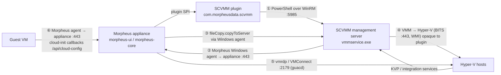
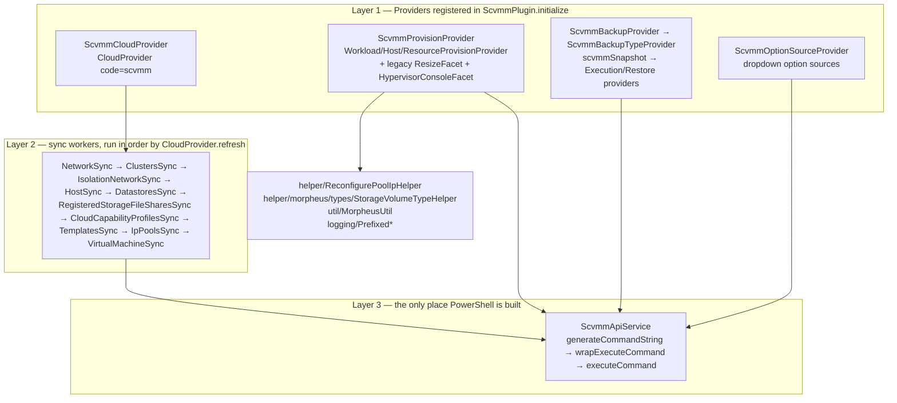
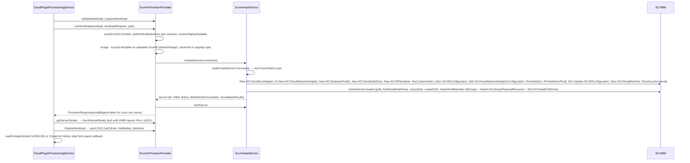

# SCVMM plugin — architecture notes

Distilled from the code on `main` and from ~35 Copilot working sessions (Sep–Oct 2026). Where a fact comes only from a session and was not re-verified against code it is marked *(session)*. Line numbers are deliberately omitted; search by symbol.

A longer, diagram-heavy design document exists in draft PR [#195](https://github.com/HewlettPackard/morpheus-scvmm-plugin/pull/195) (`docs/design/scvmm-plugin-design.md`). This file is the maintained short form.

---

## 1. System context

Communication paths the plugin depends on:

| # | Path | Used for | Failure signature |
|---|------|----------|-------------------|
| ① | `MorpheusContext.executeWindowsCommand(host, 5985, user, pass, cmd)` | every SCVMM operation | `WinRMAuthorizationError`, `Connect timed out`, cloud status `error connecting` |
| ② | Morpheus **Windows agent on the SCVMM server** | prerequisite for ③ | `ISO Upload to SCVMM Host Failed. Perhaps an agent communication issue` |
| ③ | `context.services.fileCopy.copyToServer(hypervisor, …)` | cloud-init `config.iso`, `Unattend.xml`, uploaded VHDs | same as ② |
| ④ | VMM library → host BITS over 443 served by `vmmservice.exe` | VHD copy at `New-SCVirtualMachine` | SCVMM Error 2912 `HostAgentFail` after exactly 5 min (see triage playbook) |
| ⑤ | guacd RDP `security=vmconnect` to `console_host:2179`, preconnection blob = VM GUID (`internalId`) | Hypervisor console | guacd `DNS lookup failed`, `Authentication failure` |
| ⑥ | guest → appliance | agent check-in sets `agentInstalled`/`platform`; cloud-init `runcmd` posts `/api/cloud-config/log-output/<apiKey>` which creates the **Cloud-Init** History step | `Timed out waiting for agent connectivity`, missing History step |

SCVMM only learns a guest's IP through **Hyper-V integration services (KVP)** or through a **static IP pool binding**. The plugin can never show an IP that VMM does not have.

---

## 2. Plugin components (three layers)

### 2.1 Providers ↔ morpheus-ui counterparts *(session: design-doc work, verified against code)*

| Plugin class | Core concept it replaces | Dispatched by |
|---|---|---|
| `ScvmmCloudProvider` | `ComputeZoneType` code `scvmm` (embedded `ScvmmComputeService`) | `ComputeZoneRefreshJob`, cloud CRUD |
| `ScvmmProvisionProvider` | `ProvisionType` code `scvmm` (embedded `ScvmmProvisionService`) | `CloudPluginProvisioningService` |
| `ScvmmBackup*Provider` | `BackupType` code `scvmmSnapshot` | backup/backupExecution services |
| `ScvmmOptionSourceProvider` | `optionSource` names on `OptionType` rows → `/api/options/<name>` | `optionSourceService` |

`ScvmmPlugin.onDestroy()` re-installs the embedded SCVMM seeds (`ZoneTypesSCVMMSeed`, `ProvisionTypeScvmmSeed`, …) so the embedded integration returns when the plugin is uninstalled. **Plugin upload = `plugins#delete` + install** — anything owned by a plugin-registered type (e.g. a `NetworkPoolServerType`) is destroyed and re-created with new DB ids (see ADR-0015).

### 2.2 Controller / config model

* The SCVMM management server is a `ComputeServer` of type **`scvmmController`** (created in `ScvmmCloudProvider.initializeHypervisor`); Hyper-V hosts are **`scvmmHypervisor`**; VMs are `scvmmVm` / `scvmmWindowsVm` (managed), `scvmmUnmanaged` (discovered), `scvmmLinux` (Docker host).
* `sharedController` cloud config lets several Morpheus clouds share one SCVMM server.
* Config precedence: cloud config › controller server config › defaults (`C:\morpheus` working path, `C:\morpheus\Disks` disk path, `libraryShare`). Built by `ScvmmApiService.getScvmmZoneOpts / getScvmmCloudOpts / getScvmmControllerOpts / getScvmmZoneAndHypervisorOpts / getScvmmInitializationOpts`.
* Controller lookup is duplicated with divergent fallbacks: `ScvmmCloudProvider.getScvmmController()` vs `ScvmmProvisionProvider.pickScvmmController()`.
* Credentials: `cloud.accountCredentialData` when `accountCredentialLoaded`, else `cloud.getConfigProperty('username'|'password')`. Centralised for console use in `MorpheusUtil.getConsoleUsername/getConsolePassword`.

Cloud option fields (`ScvmmCloudProvider.getOptionTypes`): `host`, `username`/`password` or credential, `workingPath`, `diskPath`, `libraryShare`, `sharedController`, `hostGroup`, `cluster`, `importExisting`, `enableVnc` (Hypervisor Console), `vmrdpConsoleSessionMode`, `hideHostSelection`, `installAgent`, `regionCode`.

### 2.3 WinRM / PowerShell transport (`ScvmmApiService`)

* `generateCommandString(cmd, depth=3)` wraps as `$FormatEnumerationLimit =-1; <cmd> | ConvertTo-Json -Depth <depth>`. VM reports use `VM_REPORT_JSON_DEPTH = 5` because per-NIC address arrays sit at depth 4; a shallower depth makes `ConvertTo-Json` **collapse arrays into whitespace-joined strings** (`normalizeAddresses` exists to tolerate legacy output).
* `wrapExecuteCommand` JSON-parses stdout into `out.data` (wrapping non-array output in `[...]`) and returns a `com.morpheusdata.model.TaskResult` (`success, exitCode (String), output, error, data, msg`). There is **no** `errorData` / `errorOutput` property — reading them throws `MissingPropertyException`.
* Scripts signal failure classes with numeric exits: `Exit 23` VM/template not found, `24` adapter, `25` VM network, `26` subnet, `27` cmdlet failed, `28` placement failed after `Update-SCVMConfiguration`. Use `if (-not $?) { Exit N }` after any cmdlet assigned to `$ignore`, otherwise non-terminating errors are invisible.
* Errors come back as CLIXML; `cleanPowerShellError` strips it for user-facing messages.
* The VMM PowerShell module exists only on the VMM server (Windows PowerShell 5.1). Hyper-V cmdlets (`Get-VMNetworkAdapter`, `Get-VMIntegrationService`) must run on the host.
* PowerShell gotchas that have bitten: hashtable keys are case-insensitive (`MACAddress` vs `MacAddress` clash), `-not $vlan.VLanId` is true for VLAN 0, Groovy `'\\\\'` emits two backslashes into the script, GStrings stored into config serialise as `{"values":…,"strings":…}` (always `.toString()`).

### 2.4 Sync workers (`ScvmmCloudProvider.refresh`)

Each worker uses `com.morpheusdata.core.util.SyncTask` (match by `externalId`, `onAdd/onUpdate/onDelete`). Order matters: `HostSync` defines the host set that `DatastoresSync` filters by; `IpPoolsSync` links pools to networks created by `NetworkSync`.

| Worker | SCVMM source | Morpheus model | Notes |
|---|---|---|---|
| `NetworkSync` | `listNetworks` — isolated VM networks (`Get-SCVMNetwork` → `VMSubnet.SubnetVLans`) and no-isolation sites (`Get-SCLogicalNetworkDefinition` → `SubnetVLans`) | `Network` (externalId `VMNetwork.ID[-VLanID]`, category `scvmm.network.<cloudId>`) + `NetworkSubnet` (externalId `VMSubnet.ID`) | Writes `cidr/gateway/dns` on **subnets** every sync, never on the parent `Network` for no-isolation nets → manual edits on the Network survive. Known bug: untagged VLAN 0 sites are skipped (`-not $vlan.VLanId`). |
| `ClustersSync` | `Get-SCVMHostCluster` | `CloudPool` ("resource pool" = SCVMM host cluster; `externalPoolId` = cluster GUID) | |
| `IsolationNetworkSync` | isolated VM networks | sets `Network.vlanId`, `cidr` | |
| `HostSync` | `listHosts` (`OverallStateString`, `AvailableForPlacement`, `PhysicalCPUCount`, `CoresPerCPU`) | `ComputeServer` type `scvmmHypervisor`, `hostname` = FQDN, `maxSockets` (#196) | Stats for existing hosts refreshed only on cluster/OS change *(session; fix on unmerged MORPH-18569 branch)*. Maintenance mode not synced. |
| `DatastoresSync` | `Get-SCStorageVolume` per host | `Datastore` with `externalType` `clustered-shared-volume` / `host-volume`, `assignedZonePools` (many-to-many), `zonePool = null` | Only volumes from hosts HostSync synced; CSV→cluster by exact membership (#192). |
| `RegisteredStorageFileSharesSync` | `Get-SCStorageFileShare` (`ClusterAssociations`, `HostAssociations`) | `Datastore` with `externalType` `clusterFileShare` / `hostFileShare` (#201) | |
| `CloudCapabilityProfilesSync` | `Get-SCCapabilityProfile` | option list for `scvmmCapabilityProfile` | |
| `TemplatesSync` | `listTemplates` | `VirtualImage` (refType `ComputeZone`) | Filters `Temporary (Morpheus )?Template <uuid>` leftovers (`ScvmmConstants.TEMPORARY_TEMPLATE_UUID_PATTERN`). |
| `IpPoolsSync` | `Get-SCStaticIPAddressPool` | `NetworkPool` type code `scvmm`, category `scvmm.ipPool.<cloudId>`; links `Network.pool` via `VMSubnet.VMNetwork.ID` | For **no-isolation** networks that id is null → pool not auto-linked (parity with embedded; link manually in Networks → Edit). On `main` there is **no IPAM provider**, so core cannot lease/release from these pools — that is PR #187 (open). |
| `VirtualMachineSync` | `listVirtualMachines` (50-VM pages, `Status -ne 'Missing'`, `HostGroupPath -like`) incl. `NetworkAdapters[]`, `Generation`, `DynamicMemoryEnabled` | `ComputeServer` (+ `syncVolumes`, `syncInterfaces`, console fields, `generation1|2` config, `hotResize`/`cpuHotResize`) | Skips servers with `status == 'provisioning'` only. `syncInterfaces` adopts adapters by externalId → IP → MAC → primary/slot → position (#189). Known bugs: `syncVolumes` zeroes `maxStorage` (save every cycle); `serverOs` compared by reference. |

Cloud refresh cadence observed on appliances: ~every 5–7.5 min; `refreshDaily` removes orphaned library items.

---

## 3. Provisioning data flow

Key facts:

* **Placement** (`getHostAndDatastore`): datastore first (online, enough space, cluster match, **most free space wins, type-agnostic**), then host (enabled, powered on, has datastore, most free memory). HA (`-HighlyAvailable`) = cluster selected **and every volume on cluster storage** (`isClusterStorage`: CSV or `clusterFileShare`); mixed cluster/local or local disks on different hosts is a validation error (#201, ADR-0001). Host maintenance mode is not considered (open, MORPH-18569).
* **Images**: synced SCVMM templates (`virtualImage.refType == 'ComputeZone'`, `isSyncdImage`) vs uploaded VHDs (`insertContainerImage` → `transferImage` → library). Linux templates are created with `-NoCustomization`; Windows unattended setup needs the image flagged **Sysprep** *and* a Morpheus License for `-ProductKey` (`appendOSCustomization`).
* **NICs at provision** (`buildCreateServerCommands`): primary + `extraInterfaces` (max `ScvmmConstants.MAX_NETWORKS = 8`, Hyper-V Gen1 synthetic limit). Pool-backed NICs: `New-SCVirtualNetworkAdapter -IPv4AddressType Static -MACAddressType Static 00:00:00:00:00:00`, then `$VNAConfigs = @(Get-SCVirtualNetworkAdapterConfiguration -VMConfiguration …)` and `Set-SCVirtualNetworkAdapterConfiguration -VirtualNetworkAdapterConfiguration $VNAConfigs[n] -IPv4Address -IPv4AddressPool` indexed by creation order. **On `main` this block is effectively dead**: `doStatic` is read from the deprecated top-level `networkConfig.doStatic` (always false for plugin provisioning) and `poolType` from `network.pool.type.code` (core does not populate `network.pool` on the marshalled model), so pool-backed NICs are created Dynamic and the granted IP stays `UnAssigned`. The fix (`resolveInterfacePoolType` reading `interface.networkPool`, per-interface `doStatic`) lives on PR #187 and is not merged — verified against code 2026-10-19.
* **cloud-init**: core builds the NoCloud ISO (`context.services.provision.buildIsoOutputStream`, label `cidata`: `meta-data`, `user-data`, `network-config`); plugin writes it to `<diskRoot>\morpheus_server_<serverId>\config.iso`, imports it to the library share and mounts it on the DVD created by `createDVD` (LUN-bump retry loop — the first failed `Create virtual DVD drive` job, Error 659, is expected noise). `deleteDvdOnComplete` is persisted in the workload config for `finalizeWorkload`. **`Remove-SCISO -Force` on an attached ISO detaches and deletes it** — never delete before cloud-init ran.
* **Clone** (`opts.cloneContainerId` = source **workload/container** id, #202): source stopped if running, `New-SCVirtualMachine -VM … -UseDiffDiskOptimization` (differencing disk → `resizeDisk` refuses), `changeVolumeTypeForClonedBootDisk`, source ISO re-created from `cloneBaseOpts`, `cloneParentCleanup` in `finally` restarts the source. Known defects on `main` (PR #193 open): `cloneParentCleanup` deletes the **clone's** ISO (`deleteDvdOnComplete.deleteIso`) instead of the parent's (`cloneBaseResults.cloudInitIsoPath`); source cloud-init cache is never reset so clones boot with the parent's identity/apiKey; `importPhysicalResource` returns a GString; clone branch pins the vSwitch with `Get-SCVirtualNetwork -Name … | Select-Object -first 1` (per-host object → wrong host fails).
* **Docker hosts / Add Node** go through `runHost` → `waitForHost` → `finalizeHost`; `runHost` and `runWorkload` drift easily (e.g. console fields only set in `runWorkload`).
* **Server saves are whole-model binds.** `context.services.computeServer.save/bulkSave` rebinds every field (`prepareForSave` excludes only account/apiKey/zone/plan/serverOs/… — **not** `agentInstalled`, `agentVersion`, `platform`, `platformVersion`). Never save a `ComputeServer` loaded before a long poll; re-fetch first (`MorpheusUtil.getMorpheusServer`). This is the root of the "agent Not Installed / platform = linux" class of bugs (#197).

---

## 4. Reconfigure (resize) path

* Plugin implements the **legacy** `WorkloadProvisionProvider.ResizeFacet` / `HostProvisionProvider.ResizeFacet`, not `ResizeV2Facet`. Consequences: core hands over the raw `ResizeRequest` and does **no** interface row creation/deletion and **no** IP-pool bookkeeping; the plugin must create/remove `ComputeServerInterface` rows itself (`context.async.computeServer.computeServerInterface.create/remove(list, server)`) and lease/release pool IPs itself (`ReconfigurePoolIpHelper`).
* `ResizeRequest` shapes: `interfacesAdd: List<Map>` (raw UI rows), `interfacesUpdate: List<UpdateModel<ComputeServerInterface>>`, `interfacesDelete: List<ComputeServerInterface>`, plus `volumesAdd/Update/Delete`, `maxMemory`, `maxCores`. Core only emits an interface **update** when network/subnet changes — an **ipMode-only change is never sent**; core also drops primary-NIC deletion.
* Flow: `resizeWorkloadAndServer` → `getResizeConfig` (hot vs stop: memory hot if dynamic memory, CPU hot only Gen2 add, **NIC add/remove forces stop on Gen1** — SCVMM Error 640) → optional stop → CPU/memory `updateServer` → volumes (`createAndAttachDisk` raw VHD, `-VolumeType None`, nothing formats/mounts it in the guest) → `reconfigureResizedInterfaces` (**remove → update → add**, stop at first failure) → start. `rtn.success = !rtn.error`.
* NIC update: `updateNetworkInterface` (`Set-SCVirtualNetworkAdapter -VMNetwork [-VMSubnet] -VLanEnabled/-VLanID [-IPv4AddressType Dynamic|Static -IPv4Addresses "<ip>"]`). Bind pool IPs by **granting to the adapter first** (`Grant-SCIPAddress -GrantToObjectType VirtualNetworkAdapter -GrantToObjectID … -Description morpheus:<vm>`) then setting `-IPv4Addresses` **without** `-IPv4AddressPools` (which double-allocates). Static adapter on a pool-less network → Error 15046 → downgrade to Dynamic.
* UI reconfigure "+ / 🗑" buttons are gated by permissions (`provisioning-reconfigure-add-network/-remove-network`), not by `getMaxNetworks()`.

---

## 5. Networking & IP addressing model

* SCVMM chain: VM vNIC → VM Network → Logical Network → Network Site (`LogicalNetworkDefinition`: subnet + VLAN + IP pool + host groups) → Uplink Port Profile → Logical Switch → Hyper-V vSwitch → pNIC. **No-isolation** VM networks have no `VMSubnet`; their subnet/pool live on the site. A logical network with no site cannot assign IPs at all.
* Morpheus `Network.externalId` = `VMNetwork.ID` optionally suffixed `-<vlan>`; always `.take(36)` before passing to `Get-SC* -ID` (Guid-typed).
* Guest IP sources at provision: SCVMM pool binding (reported pre-boot, no KVP needed), DHCP (needs KVP in guest for VMM to see it — e.g. `hyperv-daemons` on RHEL-family images), cloud-init `network-config`, Morpheus agent check-in (`externalIp`). `checkServerReady` loops up to 300× until VMM reports an IPv4 on an enabled adapter or Morpheus has `externalIp`.
* `Grant-SCIPAddress -GrantToObjectType VirtualMachine` without an object id leaves grants `UnAssigned`; VMM auto-returns **Assigned** grants on VM delete but never UnAssigned ones → pool leaks after aborted provisions.
* `ScvmmApiService.releaseIPAddress` on `main` still reads `out.errorData` (MissingPropertyException); corrected version is on PR #187 together with `ScvmmIPAMProvider` (code `scvmm-ipam`), a hidden per-cloud `NetworkPoolServer` (`scvmm-ipam.<cloudId>`, `visible=false`) and pool re-parenting in `IpPoolsSync` — required because core routes `createHostRecord/deleteHostRecord` via `pool.poolServer.type`.

---

## 6. Storage model

* `Datastore.externalType`: `clustered-shared-volume` | `host-volume` (volumes), `clusterFileShare` | `hostFileShare` (SMB shares). `assignedZonePools` scopes datastores to clusters; `zonePool` must stay null because core `DatastoreService.selectableDatastores` hides any datastore with a `zonePool` when no pool is selected. `CloudProvider.filterDatastores` is the plugin's only veto point.
* Wizard sends `resourcePoolId` as `pool-<id>` / `poolGroup-<id>` (and `pool-` for "Select"); `ScvmmOptionSourceProvider.parseResourcePoolId` normalises.
* `StorageVolume.externalId` switches from VirtualDiskDrive ID to VirtualHardDisk ID after create ("Fix up the externalId"); `internalId` = `VhdLocation`. Volume types from `StorageVolumeTypeHelper` (`scvmm-*-vhd[x]`), but `getRootVolumeStorageTypes/getDataVolumeStorageTypes` only advertise `standard` and `buildStorageVolume` sets no `type` (latent).
* Root disk on IDE 0:0 ⇒ Generation 1; data disks go to SCSI. `resizeDisk` refuses differencing disks / disks with checkpoints (self-imposed guard, same as embedded; MORPH-946 / PR #203).

---

## 7. Console (Hypervisor / guest)

* `enableVnc` on the cloud → `VirtualMachineSync` and `runWorkload` set `consoleType='vmrdp'`, `consoleHost = MorpheusUtil.getConsoleHost(parentServer)` (**FQDN**, `hostname ?: name`), `consolePort=2179`, `consoleUsername/consolePassword` = cloud credential with full `DOMAIN\user`. Hypervisor credentials belong **only** on `console*` fields; writing them to `sshUsername` broke every SSH-based core action (regression fixed in #194 — note existing rows are not self-healed).
* `ProvisionProvider.HypervisorConsoleFacet` (`updateServerHost`, `enableConsoleAccess`, shared `refreshServerPlacement`) is called by core 9.1.2 on every console connect; without it the WARN `does not implement ProvisionProvider.HypervisorConsoleFacet` appears and `consoleHost` is only refreshed by sync.
* The appliance (guacd) must resolve Hyper-V host FQDNs — DNS, not the plugin, is the usual culprit. `consoleMode=guest` is a guacd SSH session to `sshHost` using the user's Linux Settings, unrelated to `sshUsername`.

---

## 8. Build, test, release

* Gradle 9 wrapper, Java 25, Groovy 4.0.30, Spock 2.3-groovy-4.0, `morpheus-plugin-api` **1.5.1-SNAPSHOT as `provided`** (runtime classes come from the appliance — new model fields such as `maxSockets` need a `minVersion` bump or `hasProperty` guards), `minVersion=9.1.0`.
* `./gradlew test` (Spock, `forkEvery=1`; `--offline` works from cache when the Morpheus Nexus is down), `./gradlew shadowJar` → `build/libs/morpheus-scvmm-plugin-1.0.0-<ts>-<n>-<sha>-all.jar` (upload the `-all` jar; the sha tells you which code is live), `./gradlew codenarcMain` (non-failing), `jacocoTestCoverageVerification` gates minLine 20 / minBranch 30 / minInstruction 50.
* CI (`.github/workflows/ci.yml`): CodeNarc summary, gitleaks, tests, JaCoCo, then `publish-to-artifactory` on `main` (HPE Artifactory `morpheus-open-source-plugins`, `com/hpe/scvmm/morpheus-scvmm-plugin/<version>`). GitHub run artifacts are reports only.
* `functional_tests/` — pytest suite against a live appliance (needs JFrog creds for the internal library).

---

## 9. Appliance-side references (for debugging)

* Log: `/var/log/morpheus/morpheus-ui/current` (rotated files are gzip `.s`); guacd: `/var/log/morpheus/guacd/current`; plugins dir `/var/opt/morpheus/morpheus-ui/plugins/`.
* DB: `/opt/morpheus/embedded/bin/mysql -u morpheus -h 127.0.0.1 morpheus`, password `mysql.morpheus_password` in `/etc/morpheus/morpheus-secrets.json`. Useful tables/joins: `compute_server`, `compute_server_interface` via `compute_server_compute_server_interface`, `compute_server_interface_net_address`, `compute_server_storage_volume(compute_server_volumes_id, storage_volume_id)`, `datastore` (`external_type`, `zone_pool_id`) + `datastore_compute_zone_pool`, `network_pool`, `network_pool_ip` (`sub_ref_id` = interface id), `monitor_check`, `plugin_instance`. `ssh_username`, cloud config and API tokens are **encrypted at rest** — read via `GET /api/servers/<id>` instead.
* Core classes most often traced: `CloudPluginProvisioningService` (runWorkload/resizeContainer/cloneInstance/updateServerHost), `AbstractBoxProvisionService` (`waitForAgentInstall`, `buildNetworkResizeSyncLists`), `PluginNetworkPoolService`, `NetworkConfigService`, `DatastoreService.selectableDatastores`, `MonitorCheckService.expireChecks`, `GuacamoleTunnelBuilder`, `CommandWebSocket.serverInit`, `MorpheusComputeServerImplService.prepareForSave`.
* Embedded reference implementation (being deprecated): morpheus-ui `clouds/scvmm` — `ScvmmProvisionService`, `ScvmmComputeService`, `ScvmmComputeUtility`.
